ELEC 4 - Python Programming

Student: Jessie B. Maralit
Section: IV-BSIT A
Instructor: Carl Gustaf Patrik B. Ferrer

======================================

SET 1

------------

P1 - Student Grade Calculator

This program calculates the average, highest grade,
lowest grade, and pass/fail status of students.
It uses functions, input validation, and a simple menu.

Activity Folder: [P1](set1/p1/)

How to Run:
`python set1/p1/p1_grade_calculator.py`

Screenshots:

Passing Result:

Failing Result:

Input Validation:

------------

P2 - Custom Module

This program uses a custom module called student_utils.py
to calculate the average, highest, lowest, and passing
status of student grades. It also uses the datetime module
to show when the report was generated.

Activity Folder: [P2](set1/p2/)

How to Run:
`python set1/p2/p2_main.py`

Grade Report:
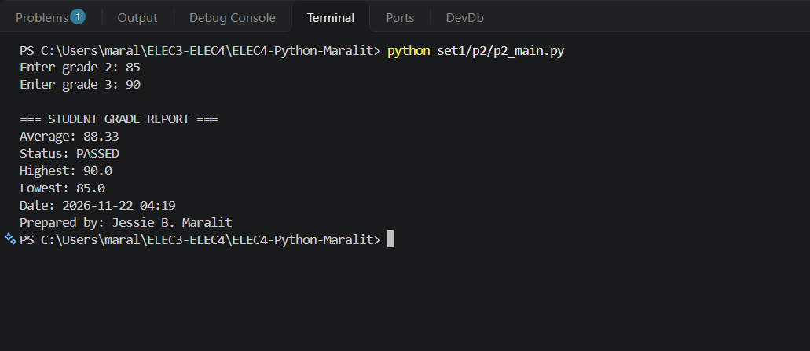

Input Validation:

------------

P3 - Student Record Manager

This program manages student records using Python
lists and sets. It allows users to add, remove,
search, and display student names. It also prevents
duplicate entries and displays students alphabetically.

Activity Folder: [P3](set1/p3/)

How to Run:
`python set1/p3/p3_record_manager.py`

Screenshots:

Add Student:
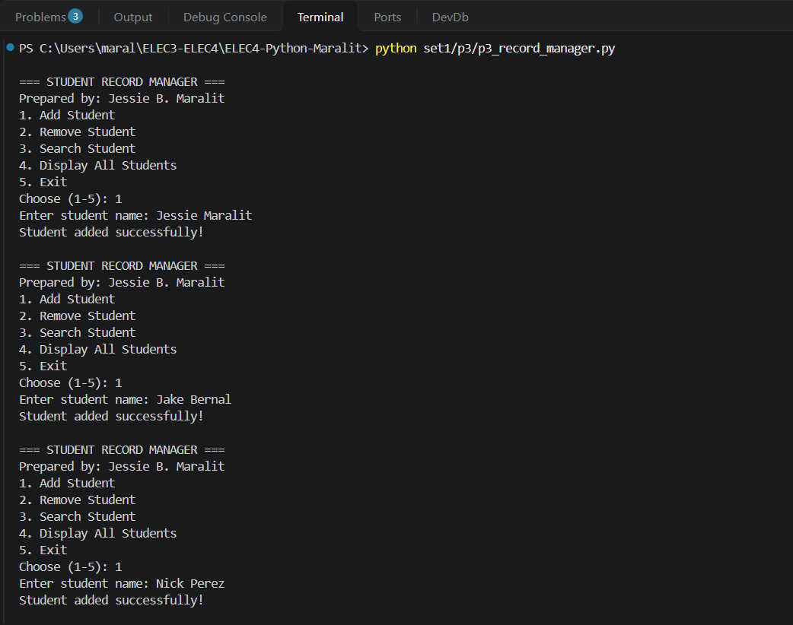

Duplicate Prevention:
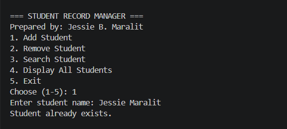

Search Student:
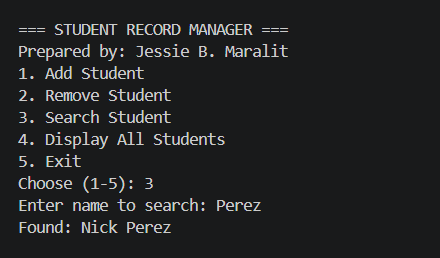

Remove Student:
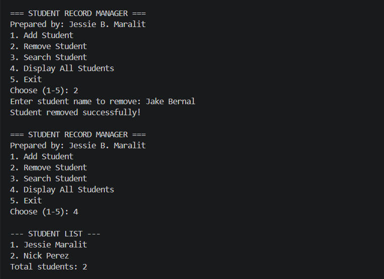

Display Students:
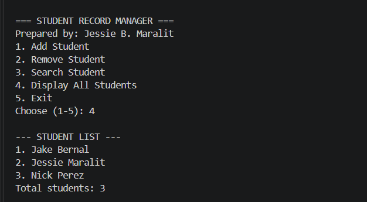

Invalid Menu:
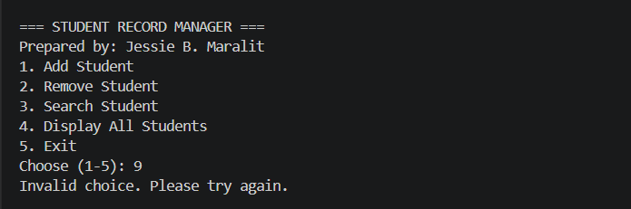

Exit Program:
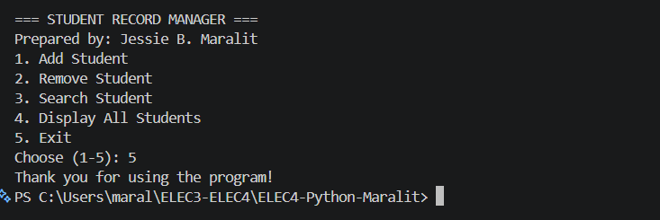

------------

P4 - Safe Menu Program

This Python program uses exception handling to
manage division, file reading, and invalid menu
selections without crashing.

It demonstrates try, except, else, and finally.

Activity Folder: [P4](set1/p4/)

How to Run:
`python set1/p4/p4_exceptions.py`

Screenshots:

Successful Division:
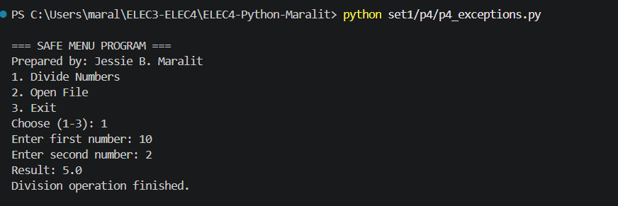

Division by Zero:
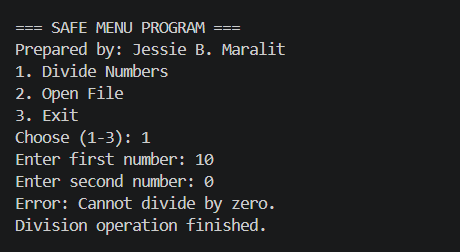

Invalid Number:
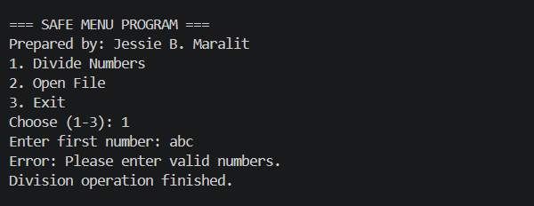

Missing File:
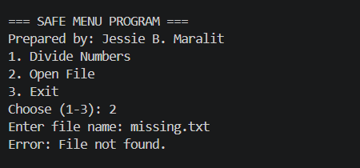

Invalid Menu:
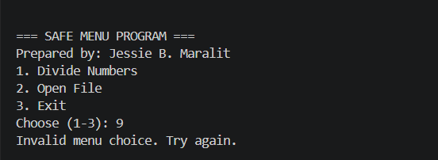

Successful File Reading:
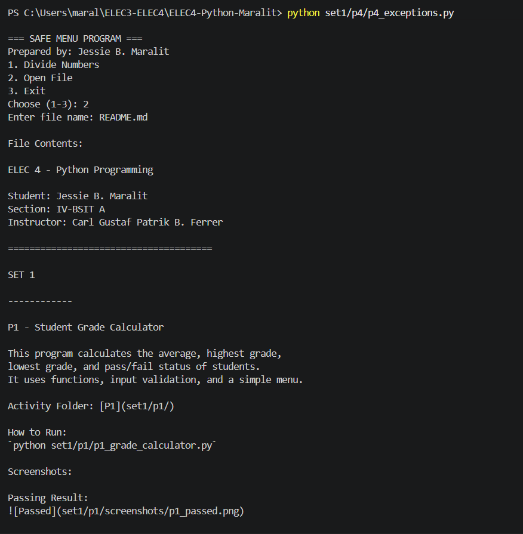

======================================

SET 2

------------

P5 - Student Information File System

------------

P6 - Recursion Toolkit

------------

P7 - Student Management System with Classes

------------

P8 - Inheritance and Polymorphism
