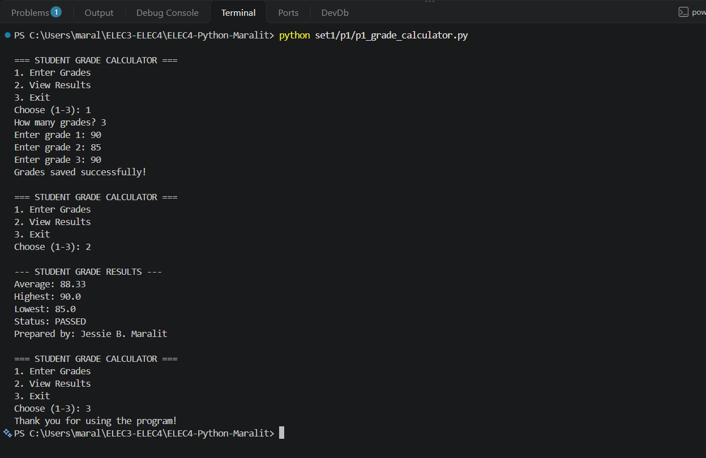
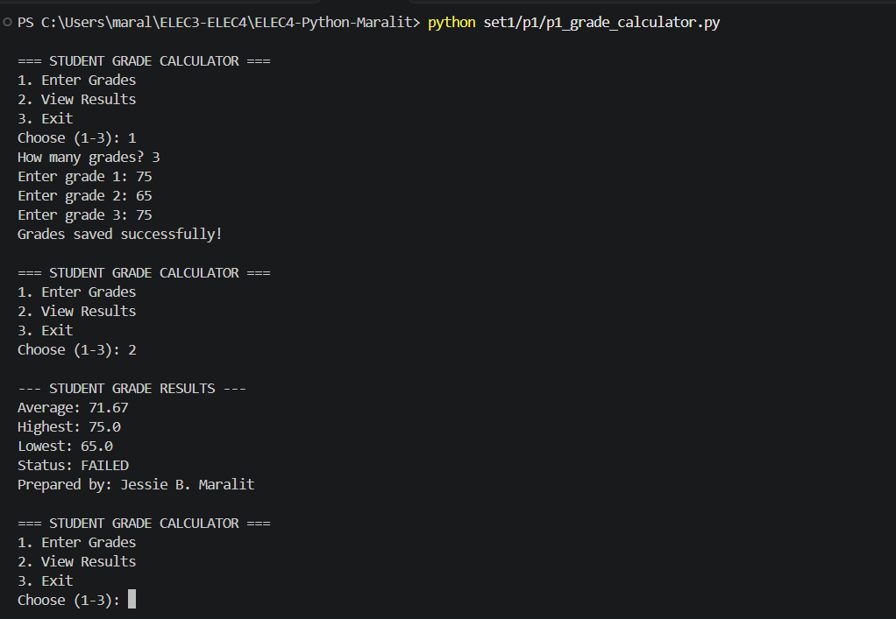
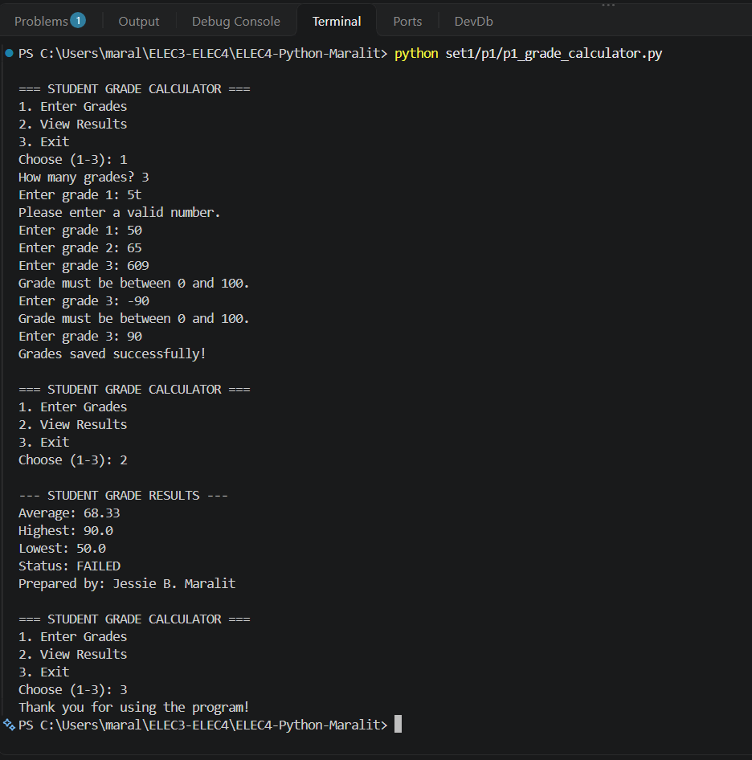
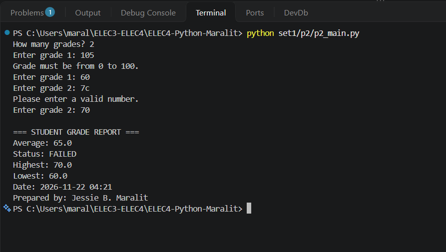

ELEC 4 - Python Programming

Student: Jessie B. Maralit
Section: IV-BSIT A
Instructor: Carl Gustaf Patrik B. Ferrer

======================================

SET 1

------------

P1 - Student Grade Calculator

This program calculates the average, highest grade,
lowest grade, and pass/fail status of students.
It uses functions, input validation, and a simple menu.

Activity Folder: [P1](set1/p1/)

How to Run:
`python set1/p1/p1_grade_calculator.py`

Screenshots:

Passing Result:

Failing Result:

Input Validation:

------------

P2 - Custom Module

This program uses a custom module called student_utils.py
to calculate the average, highest, lowest, and passing
status of student grades. It also uses the datetime module
to show when the report was generated.

Activity Folder: [P2](set1/p2/)

How to Run:
`python set1/p2/p2_main.py`

Grade Report:

Input Validation:

------------

P3 - Student Record Manager

------------

P4 - Safe Menu Program

======================================

SET 2

------------

P5 - Student Information File System

------------

P6 - Recursion Toolkit

------------

P7 - Student Management System with Classes

------------

P8 - Inheritance and Polymorphism
